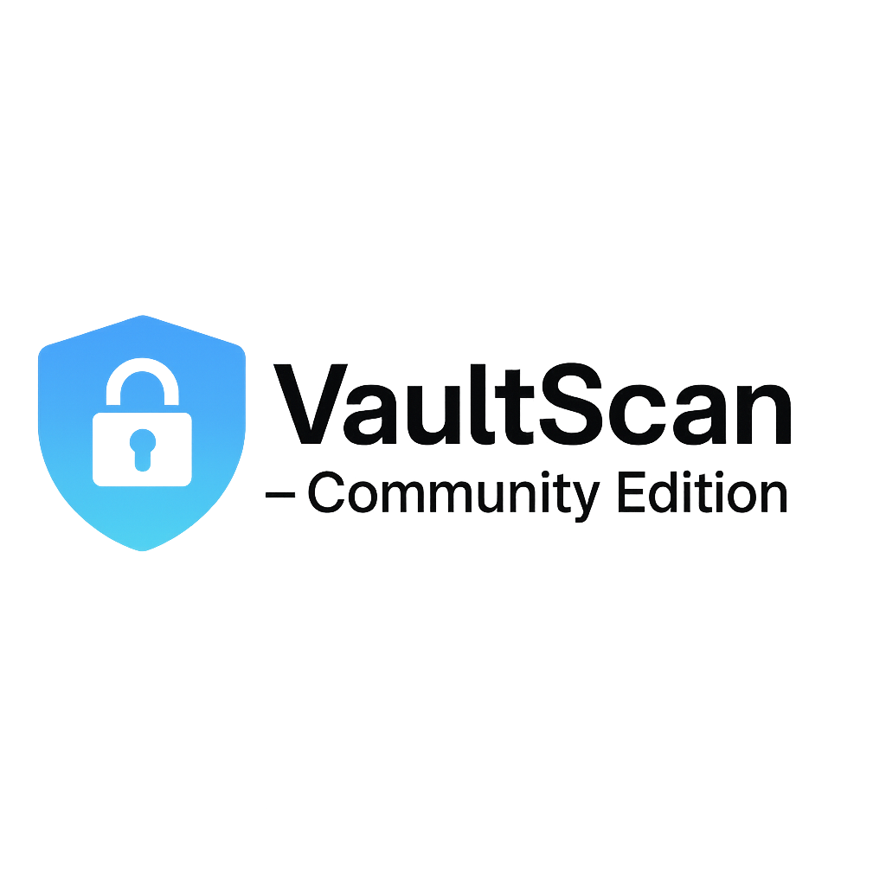

<p align="center"></p>

# VaultScan Community Edition

[](https://github.com/vaultscanhq/vaultscan-community/actions/workflows/ci.yml)
[](LICENSE)

VaultScan is a change gate for infrastructure. It reviews what is about to
ship (a Terraform plan, Kubernetes manifests, CI workflows, a shell command
proposed by an AI agent) and returns one decision:

| Verdict | Meaning | Exit code |
| --- | --- | --- |
| **ALLOW** | Nothing needs attention | 0 |
| **WARN** | Safe to proceed, findings worth fixing | 0 |
| **ASK HUMAN** | Deletes resources or changes access; a person should approve | 1 |
| **BLOCK** | Should not go ahead as it stands | 1 |

It runs locally or in CI, needs no account, and sends nothing anywhere unless
you turn on the optional AI review.

## What it checks

| Area | Command | Examples of what is caught |
| --- | --- | --- |
| Secrets | `vaultscan secrets` | Cloud keys, tokens, private keys, DB URLs with passwords, high-entropy values |
| Terraform plans | `vaultscan plan` | Destroying or replacing databases and buckets, ports open to the internet, wildcard IAM, disabled deletion protection, bulk deletes |
| Kubernetes | `vaultscan k8s` | Privileged pods, hostPath and docker.sock mounts, root containers, unpinned images, cluster-admin bindings |
| GitHub Actions | `vaultscan workflows` | `pull_request_target` with PR checkout, script injection, unpinned third-party actions, write-all tokens |
| Agent commands | `vaultscan command` | `terraform destroy`, namespace deletes, force pushes, IAM changes, destructive SQL |

The full rule list is in [docs/rules.md](docs/rules.md).

## Install

```bash
pip install git+https://github.com/vaultscanhq/vaultscan-community.git
```

Or with Docker:

```bash
docker build -t vaultscan .
docker run --rm -v "$PWD:/repo" vaultscan gate --path /repo
```

Python 3.9 or newer is required.

## Usage

Gate a repository and a Terraform plan in one go:

```bash
terraform plan -out tfplan
terraform show -json tfplan > plan.json

vaultscan gate --path . --plan plan.json --manifests deploy/
```

Run one check at a time:

```bash
vaultscan secrets --path .
vaultscan plan plan.json
vaultscan k8s deploy/                 # or: helm template ./chart > out.yaml && vaultscan k8s out.yaml
vaultscan workflows .
vaultscan command "kubectl delete namespace payments"
```

Choose an output format with `--format table|json|markdown|sarif` and write it
to a file with `--output`.

### In GitHub Actions

```yaml
permissions:
  contents: read

jobs:
  gate:
    runs-on: ubuntu-latest
    steps:
      - uses: actions/checkout@v4
      - uses: actions/setup-python@v5
        with:
          python-version: "3.12"
      - run: pip install git+https://github.com/vaultscanhq/vaultscan-community.git
      - run: vaultscan gate --path . --plan plan.json --format markdown --output "$GITHUB_STEP_SUMMARY"
```

A fuller example that produces the plan and uploads SARIF is in
[examples/github-actions-gate.yml](examples/github-actions-gate.yml).

### As a checkpoint for AI agents

Wrap the tool your agent uses to run shell commands so each command is
classified first:

```bash
vaultscan command "$PROPOSED_COMMAND" --format json
```

Exit code 0 means run it. Exit code 1 means stop: the JSON `verdict` is either
`ASK_HUMAN` (pause and show the person the reason) or `BLOCK`.

## AI review

Add `--ai` to any command and a model writes the review: what the change does,
why it matters for the resources involved, and what to fix first.

```bash
export VAULTSCAN_AI_PROVIDER=ollama        # or anthropic, openai
export VAULTSCAN_AI_MODEL=llama3.1
vaultscan plan plan.json --ai
```

The verdict stays rule-based. The model can raise a decision to ASK HUMAN, but
it can never lower one, and secret values are redacted before anything is sent.
Details and provider setup are in [docs/ai.md](docs/ai.md).

## Policy

Put a `.vaultscan.yml` in the repository root to tune the gate:

```yaml
block_on: critical        # severity that blocks
warn_on: medium           # severity that warns
max_deletes: 5            # bulk-delete threshold for Terraform plans
ignore_rules:
  - K8S-006
severity_overrides:
  TF-009: high
```

Files can be excluded from secret scanning with `.vaultscanignore` (gitignore
style), and a single line with a trailing `# vaultscan:ignore` comment.

## Development

```bash
pip install -e ".[dev]"
pytest
```

## License

Apache-2.0. See [LICENSE](LICENSE) and [.github/NOTICE](.github/NOTICE).

Developed by [Pavan Gajjala](https://github.com/pavangajjala).
